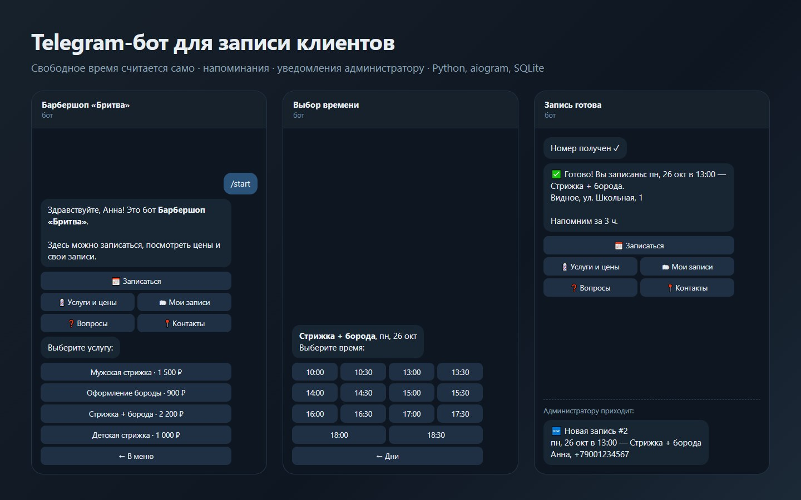
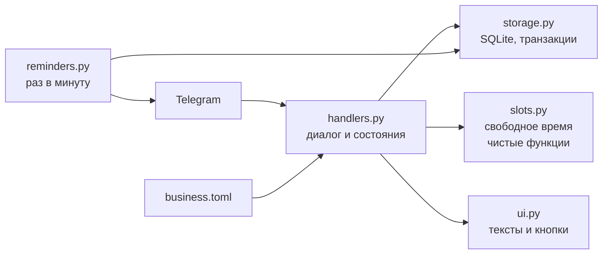

# Telegram-бот для записи клиентов



**Бот для салона, барбершопа, мастерской или частного специалиста: клиент сам выбирает услугу, день и свободное время, бот напоминает о визите и сообщает администратору о каждой записи и отмене.**

**[Попробовать в браузере →](https://chop-prog.github.io/booking-bot/)** — тот же сценарий записи без Telegram, с панелью «что видит администратор».

Python · aiogram 3 · SQLite · pytest. Услуги, цены, часы работы и ответы на вопросы задаются в одном файле [`business.toml`](business.toml) — менять их можно без программиста.

_English: a Telegram bot for booking appointments. Clients pick a service, a day and a free time slot; the bot checks clashes atomically, reminds clients before the visit and notifies admins. Business settings live in one TOML file. 28 pytest tests drive the whole conversation through a fake Telegram API._

## Что умеет

**Для клиента:**
- меню с кнопками: «Записаться», «Услуги и цены», «Мои записи», «Вопросы», «Контакты»;
- запись в 4 шага: услуга → день → свободное время → имя и телефон (можно отправить номер одной кнопкой) → подтверждение;
- показывается только реально свободное время: учитываются длительность услуги, часы работы, выходные, уже занятые записи и минимальный запас до начала (по умолчанию 1 час);
- «Мои записи» — список будущих визитов с кнопкой отмены;
- напоминание за 3 часа до визита (настраивается).

**Для администратора:**
- сообщение о каждой новой записи и отмене: услуга, время, имя, телефон;
- команды `/today` и `/week` — расписание на сегодня и на неделю. Клиентам эти команды не отвечают.

**Надёжность:**
- если двое одновременно выбрали одно время, запишется только первый: проверка пересечений и запись идут в одной транзакции SQLite (`BEGIN IMMEDIATE`). Второму бот предложит оставшееся свободное время;
- кнопки из старых сообщений не ломают бота: устаревшая услуга или занятое время дают понятное сообщение;
- телефон проверяется и приводится к виду `+79001234567`; чужой контакт не принимается.

## Как устроено



| Файл | Что внутри |
|---|---|
| [`bot/slots.py`](bot/slots.py) | Расчёт свободного времени — без Telegram и базы, поэтому легко тестируется |
| [`bot/storage.py`](bot/storage.py) | Записи в SQLite: создание без двойной записи, отмена только своей записи, напоминания |
| [`bot/handlers.py`](bot/handlers.py) | Диалог на aiogram 3: меню, пошаговая запись (FSM), «Мои записи», команды администратора |
| [`bot/ui.py`](bot/ui.py) | Тексты, форматирование дат и цен, клавиатуры |
| [`bot/reminders.py`](bot/reminders.py) | Фоновая задача напоминаний |
| [`business.toml`](business.toml) | Настройки бизнеса (демо: вымышленный барбершоп) |
| [`web/`](web) | Веб-демо для браузера: те же услуги (`business.json` выгружается из `business.toml`) и те же правила слотов, проверенные `node:test` |

## Тесты

28 тестов на pytest. Кроме логики слотов и базы, тесты **проходят весь диалог целиком** через поддельный Telegram ([`tests/conftest.py`](tests/conftest.py)): «клиент» пишет сообщения и нажимает кнопки, а тест проверяет, что бот ответил. Проверяются полная запись с уведомлением администратора, исчезновение занятого времени, гонка двух клиентов за одно время, проверка телефона, отмена, команды администратора и напоминания.

Картинка выше нарисована по такому же прогону ([`tools/render_demo.py`](tools/render_demo.py)): тексты и кнопки на ней — настоящие ответы бота.

```bash
python -m pytest -q
```

## Запуск

1. Создайте бота у [@BotFather](https://t.me/BotFather) и получите токен.
2. Узнайте свой Telegram ID (например, у [@userinfobot](https://t.me/userinfobot)) — на него будут приходить записи.
3. Установите зависимости и запустите:

```bash
python -m venv .venv
.venv/bin/pip install -r requirements.txt        # Windows: .venv\Scripts\pip
export BOT_TOKEN=123456:ABC...                   # Windows PowerShell: $env:BOT_TOKEN="..."
export ADMIN_IDS=111111111                       # несколько — через запятую
python -m bot
```

Записи хранятся в `bookings.sqlite3` (путь меняется переменной `DB_PATH`). Для работы 24/7 бот запускают на любом VPS как службу systemd или в Docker. Ему не нужен открытый порт: он сам опрашивает Telegram (long polling).

## Как сделано

Бот написан вместе с AI-ассистентом Claude Code: я продумал сценарий записи и крайние случаи (двойная запись, старые кнопки, чужой контакт), проверял поведение на тестах и правил тексты.

MIT License.
